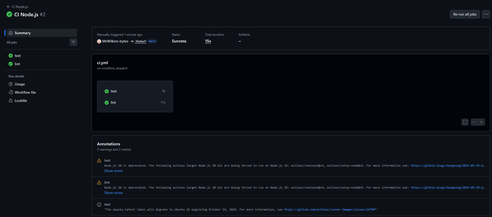
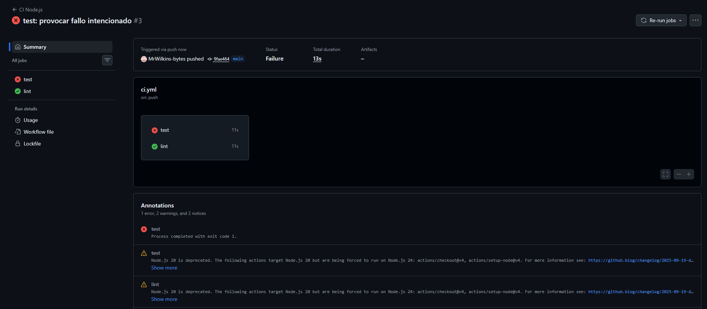
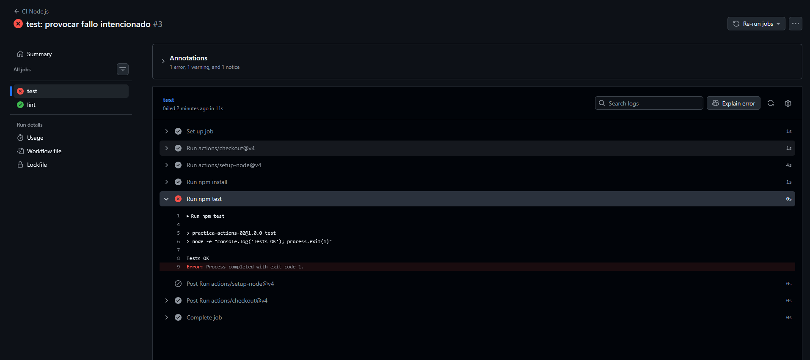
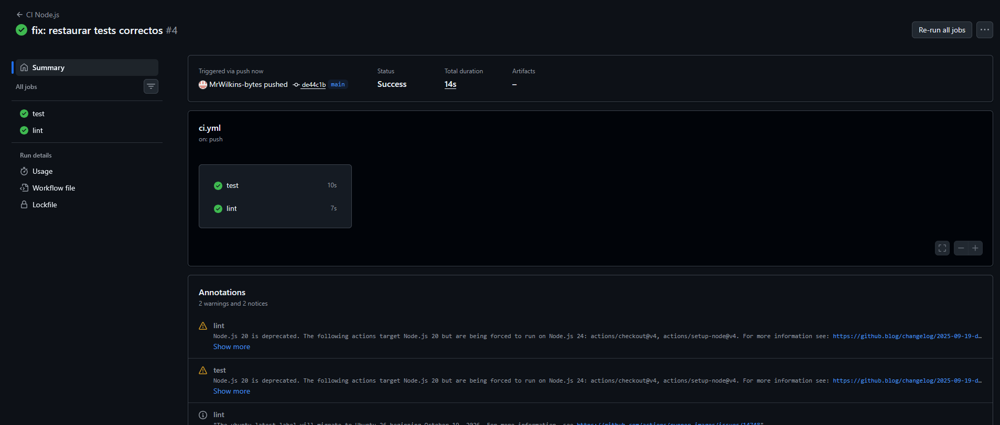

# Práctica 2: Pipeline de CI con una App Real

**Alumno:** Alex Hartley Wilkins  
**Módulo:** Entornos de Desarrollo  
**Repositorio:** [practica-actions-02](https://github.com/MrWilkins-bytes/practica-actions-02)

## 1. Objetivo

Crear un proyecto mínimo de Node.js y configurar un pipeline de Integración Continua (CI) con GitHub Actions. Se ejecutan tests simulados, se comprueba la versión de Node.js y se practica el diagnóstico y la corrección de un fallo.

## 2. Preparación del proyecto

Se creó un repositorio independiente y se inicializó Git:

```bash
cd ~/Documents/1ºDAM/EntornoDesarrollo
mkdir -p practica-actions-02
cd practica-actions-02
git init -b main
gh repo create MrWilkins-bytes/practica-actions-02 --public --source=. --remote=origin
```

Se generó el proyecto Node.js y se definió el script de prueba:

```bash
npm init -y
npm pkg set 'scripts.test=node -e "console.log('\''Tests OK'\''); process.exit(0)"'
```

El script muestra `Tests OK` y termina con código `0` cuando el test funciona correctamente.

## 3. Workflow de GitHub Actions

Archivo: `.github/workflows/ci.yml`

```yaml
name: CI Node.js

on:
  push:
    branches: [main]
  workflow_dispatch:

jobs:
  test:
    runs-on: ubuntu-latest
    steps:
      - uses: actions/checkout@v4
      - uses: actions/setup-node@v4
        with:
          node-version: '20'
      - run: npm install
      - run: npm test

  lint:
    runs-on: ubuntu-latest
    steps:
      - uses: actions/checkout@v4
      - uses: actions/setup-node@v4
        with:
          node-version: '20'
      - run: node --version
```

El job `test` configura Node.js 20, instala las dependencias y ejecuta las pruebas. El job `lint` comprueba la versión de Node.js. Al no existir dependencias `needs`, ambos jobs pueden ejecutarse en paralelo.

## 4. Subida inicial y comprobación

```bash
git add .
git commit -m "chore: proyecto Node inicial con CI"
git branch -M main
git push -u origin main

gh workflow run ci.yml --repo MrWilkins-bytes/practica-actions-02 --ref main
gh run list --repo MrWilkins-bytes/practica-actions-02 --limit 3
gh browse --repo MrWilkins-bytes/practica-actions-02 --actions
```

## 5. Provocar un fallo intencionado

Se cambió el código de salida del test de `0` a `1` para simular un fallo:

```bash
sed -i 's/process\.exit(0)/process.exit(1)/' package.json
git add package.json
git commit -m "test: provocar fallo intencionado"
git push
```

Se consultó la ejecución y se revisó el log del paso `npm test`:

```bash
gh run list --repo MrWilkins-bytes/practica-actions-02 --limit 3
gh run view 38642878015 --repo MrWilkins-bytes/practica-actions-02
```

El código de salida `1` hace que el job `test` falle. El pipeline identifica así el problema automáticamente.

## 6. Corrección del fallo

Se restauró el código de salida `0`:

```bash
sed -i 's/process\.exit(1)/process.exit(0)/' package.json
git add package.json
git commit -m "fix: restaurar tests correctos"
git push

gh run list --repo MrWilkins-bytes/practica-actions-02 --limit 3
git status
```

Tras la corrección, el pipeline volvió a finalizar correctamente y el repositorio quedó actualizado.

## 7. Evidencias

Todas las capturas se encuentran en la carpeta `img/`.

### Evidencia 01: pipeline inicial en verde

Los jobs `test` y `lint` aparecen en verde.



### Evidencia 02: pipeline en rojo

Vista general de la ejecución fallida después de provocar el error intencionadamente.



### Evidencia 03: log del fallo

Detalle del paso `npm test`, mostrando el error y el código de salida `1`.



### Evidencia 04: pipeline corregido en verde

Tras restaurar `process.exit(0)`, los jobs finalizan correctamente.



## 8. Reflexión final

- **`uses` frente a `run`:** `uses` reutiliza acciones mantenidas, como `actions/setup-node`; `run` ejecuta comandos en el runner.
- **Paralelismo:** los jobs independientes se ejecutan en paralelo porque no tienen una dependencia `needs`.
- **Diagnóstico:** el log permite identificar el comando fallido y su código de salida.
- **Ciclo de CI:** se verificó el pipeline en verde, se provocó un fallo, se diagnosticó y se corrigió para recuperar el estado correcto.

## 9. Repositorio

[Ver practica-actions-02 en GitHub](https://github.com/MrWilkins-bytes/practica-actions-02)
